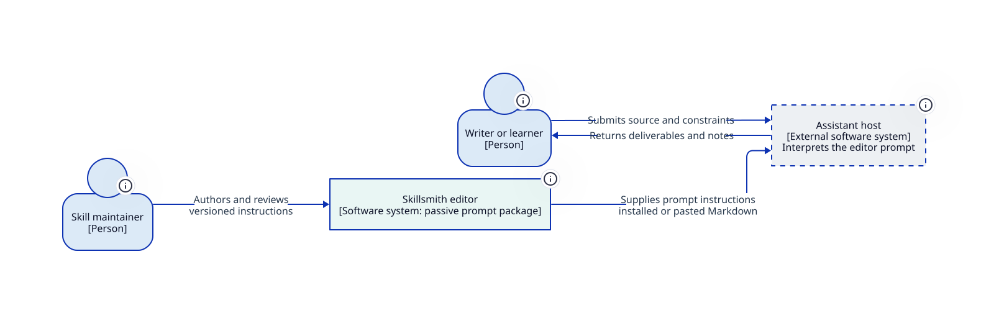
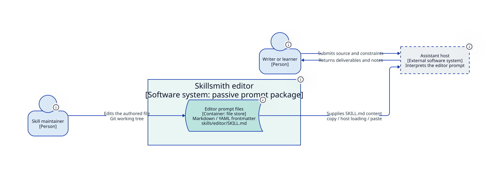
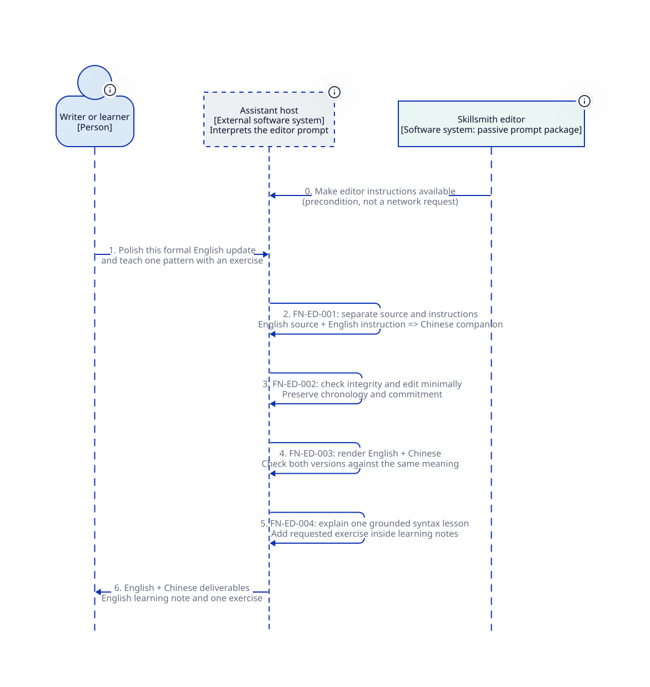

# Editor: C4 design from the implementation

Start with the [architecture specification](architecture-spec.md) for exact request decisions, language policy, edit/lesson behavior, trust boundaries and unresolved design questions. This is an implementation projection prepared for human review, not a claim of complete requirements alignment or executed model quality.

The editor is a passive Markdown package. Its one C2 container is a file store; the assistant host executes externally. The model does not turn editing, translation or teaching into invented services.

## Context



## Container



## Editing and learning



## Boundary scenarios

- [Misleading translation request with no notes](diagrams/integrity-no-notes.svg)
- [Transcript editing without audio evidence](diagrams/transcript-boundary.svg)

## Sources and reproduction

[model.d2](model.d2) owns diagram entities and structural relationships. C1/C2 views import and filter the model. Dynamic views import the same participants and describe ordered interactions; they do not add services. Generated SVGs are previews and are never edited manually. The [architecture specification](architecture-spec.md) holds behavior, constraints and open decisions together, with links to historical contract provenance. The [shared architecture](../portable-skills.md) defines common responsibility boundaries.

Use Python 3.9+ and D2 0.7.0+ on PATH (rendered with D2 0.9.0 and ELK). From the repository root:

```bash
python3 design/architecture/editor-c4/scripts/architecture.py format
python3 design/architecture/editor-c4/scripts/architecture.py check
python3 design/architecture/editor-c4/scripts/architecture.py render
python tests/validate_skills.py
```

The helper is adapted from the invoked `c4-architecture` skill's portable template; only its documented invocation path changes. It checks required views, basic model-import discipline, syntax, formatting and rendering. Semantic fidelity and readable layout still require inspection. No D2 dependency is added to product invocation or CI.

Assumptions, known requirement/implementation drift, proposed refinements and human review status are in the specification. No architecture approval is inferred from passing commands.
