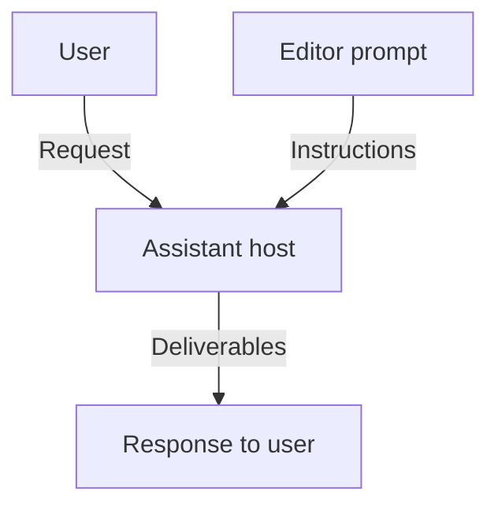

# Editor architecture view

This view explains how supplied-text editing and translation use Skillsmith's shared portable-prompt architecture. The assistant host interprets the editor prompt; Skillsmith supplies Markdown instructions and quality checks. This is a focused projection of the linked definitions, not a complete account of every editor capability or new evidence of model quality.

## Context and execution boundary

The prompt contributes the [portable invocation contract, IF-PROMPT](../portable-skills.md#interfaces-and-data-flow); it is an authored asset, not an executing service. The host supplies `$ARGUMENTS` and produces the response. Missing or unsafe source input follows the [editor error and boundary behavior](../../requirements/editor.md#error-and-boundary-behavior). The logical processing sequence is owned by [editor flow and state](../../system/editor.md#flow-and-state).

## Responsibilities and allocation

The following selection comes from the shared [Module allocation](../portable-skills.md#responsibility-and-allocation) and [Interface definitions](../portable-skills.md#interfaces-and-data-flow). These are responsibility boundaries, not additional runtime processes.

| Responsibility | Editor participation | Contract or source |
| --- | --- | --- |
| Author portable prompt behavior — MOD-PROMPT | All four editor Functions: resolve roles, refine meaning, render deliverables, explain edits and verify consistency | [FN-ED-001–004](../../system/editor.md#functions); IF-PROMPT |
| Check repository structure — MOD-QUALITY | Validate prompt structure and static eval fixtures; check catalog synchronization | IF-STATIC supplies errors/warnings to contributors and reviewers |
| Assess skill quality — MOD-REVIEW | Assess fidelity, output behavior and safety using actual evidence | IF-SKILL-REVIEW supplies an attributed assessment to the contributor |

Structure checks and reviewer assessments occur during maintenance, outside the user's editing request. A passing static check does not demonstrate correct model output.

## Realization and installation

| Realization | Purpose in this view |
| --- | --- |
| [Editor prompt](../../../skills/editor/SKILL.md) | Authored metadata, instructions and output format interpreted by the host |
| [Editor eval scenarios](../../../tests/evals/skills/editor/cases.yaml) | Expected observable behavior for review; the fixture is not a model execution log |
| [Skill validator](../../../tests/validate_skills.py) | Deterministic prompt and fixture checks |
| [README synchronization check](../../../tests/check_readme_sync.py) | Catalog and documented invocation consistency |
| [CI workflow](../../../.github/workflows/validate.yml) | Runs the repository's deterministic validation commands |
| [Installer](../../../install.sh) | Copies skill assets to the selected destination |

The [shared realization](../portable-skills.md#realization-and-development-view) covers installed or copy-pasted Markdown consumed by an assistant host. The editor introduces no Skillsmith-owned server, database or persistent learner profile. Host infrastructure is outside this view; RigorLoop's local maintenance store is separate from product invocation.

## Scenario: target-only translation without notes

This walkthrough projects [requirement example E9](../../requirements/editor.md#examples-first) and [edge case EC11](../../requirements/editor.md#ec11). It describes intended participation, not an executed model test.

| Step | Participation and observable result | Owning basis |
| --- | --- | --- |
| Request | User supplies Chinese source text with “Only translate this into English. No notes.” | E9; EC11 |
| Interpretation | Host interprets the editor instructions, distinguishing the source from the target-only and note-suppression directions | [FN-ED-001](../../system/editor.md#functions); [R9–R11](../../requirements/editor.md#r9) |
| Response | Host returns only the English deliverable, preserving source meaning and tone; it omits both a Chinese deliverable and learning notes | [R34–R37](../../requirements/editor.md#r34), [R49](../../requirements/editor.md#r49); FN-ED-002–004 |
| Integrity boundary | If the request also asks for a misleading transformation, integrity takes priority: refuse or redirect, offer an accurate alternative when possible, and still honor explicit note suppression | [R51–R56](../../requirements/editor.md#r51) |

The internal editing sequence remains in the system definition. The scenario connects the existing user/host boundary to observable obligations; it does not introduce separate translation or teaching services.

## Sources and maintenance

[Editor requirements](../../requirements/editor.md) own observable obligations; [editor system behavior](../../system/editor.md) owns Function meaning and order; [portable-skill architecture](../portable-skills.md) owns allocation, Interfaces and realization. Names and relationships in this view are selected from those owners. When an owning definition changes, reconcile the affected table or Mermaid block in the same change and inspect its rendered presentation. No separate generated image is authoritative.

The view covers the supplied-text path and one scenario. Audio-specific behavior, the full learning-note design and catalog-wide coverage are outside this projection. Existing evidence limits, including the named fidelity-case fixture gap, remain recorded in [editor test intent](../../system/editor.md#test-intent).
