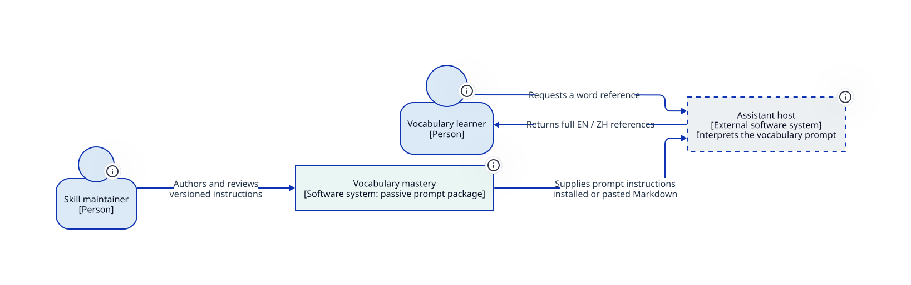
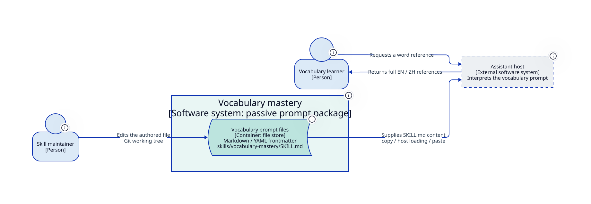
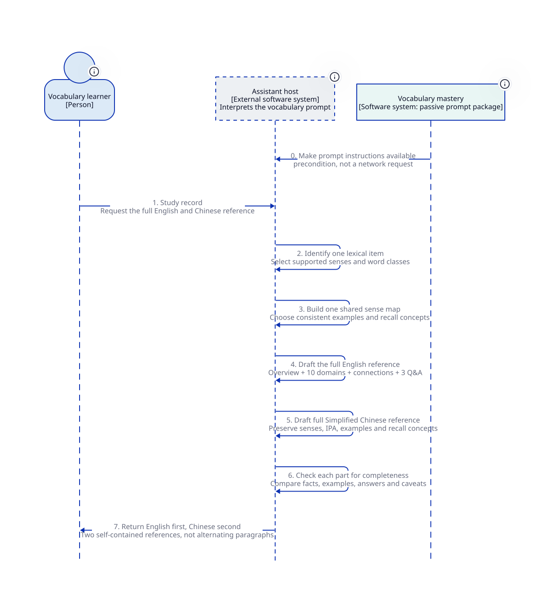

# Vocabulary mastery: C4 design from implementation

Read the [architecture specification](architecture-spec.md) for the single-target decision rules, shared sense map, ten-domain responsibilities, exact English/Chinese output contract, quality boundaries and open design questions. This package is prepared for human review; the behavior and constraints in its specification still need human acceptance.

The skill supplies a passive Markdown package. An external assistant host generates two full references from its instructions. The sense map and ten dimensions are logical concerns, not separate services or persisted data stores.

## Context



## Container



## Full English and Chinese references



## Boundary scenarios

- [Several targets: clarify one and preserve its contextual sense](diagrams/target-clarification.svg)
- [User-created word: complete structure without invented lexical facts](diagrams/coinage-boundary.svg)

## Source and reproduction

The [model](model.d2) owns diagram identities and structural relationships. Context/container views import and filter it. Dynamic views reuse those participants and show scenario-specific messages. The [prompt](../../../skills/vocabulary-mastery/SKILL.md) and [fixtures](../../../tests/evals/skills/vocabulary-mastery/cases.yaml) are the observed implementation basis; they do not become accepted requirements through reverse engineering.

Generated SVGs are previews; edit D2 sources and render again. Use Python 3.9+ and D2 0.7.0+ on PATH. These views were generated with D2 0.9.0 and ELK. From the repository root:

```bash
python3 design/architecture/vocabulary-mastery-c4/scripts/architecture.py format
python3 design/architecture/vocabulary-mastery-c4/scripts/architecture.py check
python3 design/architecture/vocabulary-mastery-c4/scripts/architecture.py render
python tests/validate_skills.py
```

The helper reuses the invoked C4 skill's portable template with its invocation path adapted to this package. Its basic policy/syntax/render checks do not establish semantic correctness or human approval. No D2 dependency is added to invocation or CI. Host deployment, learning effectiveness and measured model quality remain outside the demonstrated result.
