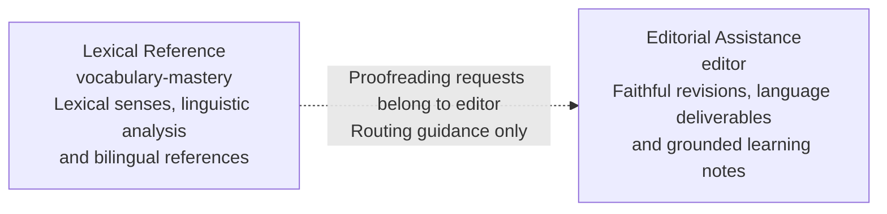

# Editor context map

This is a proposed DDD interpretation of the current skill instructions, not a record of accepted architecture or observed model compliance. See the [glossary](../glossary.md#ddd-terminology) for terminology and the [editor design](README.md) for behavior tables and scenario sequences.

## Purpose and boundary

**Editorial Assistance** helps an author improve or translate supplied material while preserving meaning and grounding any learning notes in observable language choices.

Treat it as one candidate [bounded context](../glossary.md#bounded-context). Editing, translation and teaching share the same source interpretation, request constraints and fidelity rules. They are internal capabilities, not independently integrated contexts.

The context owns:

- Separating the editing request from source material and identifying available evidence.
- Choosing visible languages according to the user's request and the skill's defaults.
- Making restrained revisions and preserving facts, intent, uncertainty and commitments across deliverables.
- Selecting grounded learning notes, honoring suppression and distinguishing text evidence from accessible audio.

It does not establish ongoing tutoring, a comprehensive lexical-reference workflow, persistent learner tracking, publication, or independent fact-verification services. These exclusions do not remove its existing requested practice or translation capabilities.

## Context map

Both boxes are candidate domain-model boundaries. The dotted arrow is documented routing guidance, not a data exchange or implemented automatic invocation.

## Relationship and evidence

| Relationship | Evidence | Meaning and limit |
| --- | --- | --- |
| Lexical Reference refers proofreading requests to Editorial Assistance | [Vocabulary mastery: Accuracy and input boundaries](../../skills/vocabulary-mastery/SKILL.md#accuracy-and-input-boundaries) | The instructions direct plain proofreading to editor. They define no invocation API, transferred record or automatic dispatch guarantee. |

A lexical reference develops an account of a word or expression; editor revises or translates supplied material for a communication purpose. Shared linguistic terminology does not establish a shared domain model or an upstream/downstream contract. No team relationship pattern is asserted.

The current editor instructions establish no cross-skill data integration. Additional neighboring contexts or handoff contracts should be added only when supported by evidence or explicitly proposed as new work.

## Language and rules within the boundary

Use the context-scoped definitions of [source](../glossary.md#source), [editing request](../glossary.md#editing-request), [source meaning](../glossary.md#source-meaning), [revision](../glossary.md#revision), [language deliverable](../glossary.md#language-deliverable) and [learning note](../glossary.md#learning-note).

The shared rules explain the boundary: truthfulness constrains edits; requested outputs preserve the same meaning; teaching is grounded in real changes and cannot justify inventing edits. These are instructed behaviors, not a deterministic enforcement mechanism. Exact precedence, language selection, suppression and evidence rules remain in [SKILL.md](../../skills/editor/SKILL.md).

The [existing workflow views](README.md#scenario-walkthroughs) explain the order of activities inside the context. The assistant host and skill files concern execution and packaging; they are not modeled here as additional domain contexts.

## Review questions

- Does a proposed capability still use the same source meaning and fidelity rules, or introduce a genuinely different model?
- Does a proposed handoff define information and its interpretation, or only recommend another skill?
- Can each claimed relationship be traced to instructions or an implemented contract?
