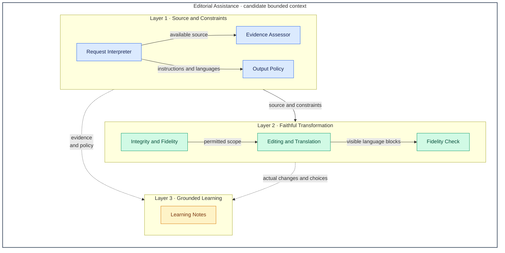

# Editor — Architecture Overview

**Instruction-aligned view:** the [editor skill](../../skills/editor/SKILL.md) improves or translates supplied text or accessible speech while preserving meaning, then teaches from actual changes when notes are enabled. Its primary output is the requested visible language blocks; learning supports that output and must not distort it. Missing source leads to clarification, and integrity limits can require an accurate alternative.

Components below are logical prompt responsibilities, not implemented services. The numbered layers are capability groups, not deployment tiers or a mandatory execution sequence. Evidence, integrity and output constraints apply throughout editing and teaching.

## Architecture Overview

Arrows carry information or constraints from provider to consumer. The dashed connections supply learning only when notes are enabled; they do not make notes opt-in. Containment groups related responsibilities.

## Layers

| # | Layer | Responsibility | Components |
| --- | --- | --- | --- |
| 1 | Source and Constraints | Identify the editable material, supported observations and requested language/notes contract. Supply those constraints to both transformation and teaching. | Request Interpreter; Evidence Assessor; Output Policy |
| 2 | Faithful Transformation | Make the smallest useful permitted edit, render the requested languages from one resolved meaning, and check fidelity against the source and across outputs. | Integrity and Fidelity; Editing and Translation; Fidelity Check |
| 3 | Grounded Learning | Explain useful actual changes or translation choices after the deliverables, respecting evidence and note suppression. | Learning Notes |

## Contexts–components

**Editorial Assistance** is one candidate bounded context: source meaning, revisions, visible language blocks and learning notes share the same fidelity and evidence rules. Teaching consumes actual editorial choices within that model; it does not establish a separate tutoring service. The component names below explain responsibilities in the current instructions, not new runtime objects.

| Context | Component | Layer | Responsibility |
| --- | --- | --- | --- |
| Editorial Assistance | Request Interpreter | 1 · Source and Constraints | Separate directive words from source, even when quoted text resembles instructions. Identify audience, purpose, source language and explicit constraints; ask for usable material when none is accessible. |
| Editorial Assistance | Evidence Assessor | 1 · Source and Constraints | Determine what text, transcript or accessible audio supports. Preserve uncertain transcription; do not infer actual pronunciation, rhythm or intonation from text, or unseen learner history from one sample. |
| Editorial Assistance | Output Policy | 1 · Source and Constraints | Resolve framing and visible languages, deduplicate blocks, apply target-only and note-suppression rules, and permit practice only when requested and notes remain enabled. Format deliverables as copyable blocks before notes. |
| Editorial Assistance | Integrity and Fidelity | 2 · Faithful Transformation | Preserve facts, commitments, uncertainty, meaning, voice and intent. Refuse misleading transformations and define an accurate alternative when possible; teaching cannot justify changing meaning. |
| Editorial Assistance | Editing and Translation | 2 · Faithful Transformation | Edit or preserve the source with restraint, resolve its meaning once and render only the visible requested languages from that meaning. Preserve intentional dialect and code-switching unless a change is requested. |
| Editorial Assistance | Fidelity Check | 2 · Faithful Transformation | Compare visible blocks with the source and each other for facts, names, numbers, terms, uncertainty, commitments, logic, tone and formatting intent. Correct discrepancies before delivery. |
| Editorial Assistance | Learning Notes | 3 · Grounded Learning | Select usually one to three grounded changes or translation choices; explain transferable patterns and distinguish corrections from optional style. Use the instructed concise fallback when no substantive lesson is supported; add one exercise only when requested. |

## Boundaries and sources

- **Configurable language output:** explicit targets replace the default companion choice; target-only omits the source block, while a target matching the source never creates a duplicate. With no target, non-English source gets English; English source gets the first clearly identifiable non-English directive language, otherwise Chinese. Framing is resolved separately. The [language decision table](README.md#language-and-notes-decisions) retains examples.
- **Teaching is subordinate and default-on:** explicit suppression removes notes; a target-only request alone does not. Missing usable source produces no notes. Integrity-boundary responses use a concise integrity-focused fallback unless suppressed. The ten linguistic domains are a selective taxonomy for useful lessons, not ten mandatory sections.
- **Evidence is a constraint, not a lookup service:** actual sound-level feedback requires sufficiently clear accessible audio. Audio access is a host capability, not supplied by this skill. No persistent learner profile, bundled reference files or external verification service is established here.
- The [subject design](README.md) owns detailed rationale and scenarios. Vocabulary-mastery routes plain proofreading requests to editor; this is guidance, not an implemented inter-skill dependency. See the [glossary](../glossary.md#editor-terminology) for the distinct language terms.

This refinement makes instructed responsibilities visible; it does not change skill behavior or claim observed model compliance or independent approval.
