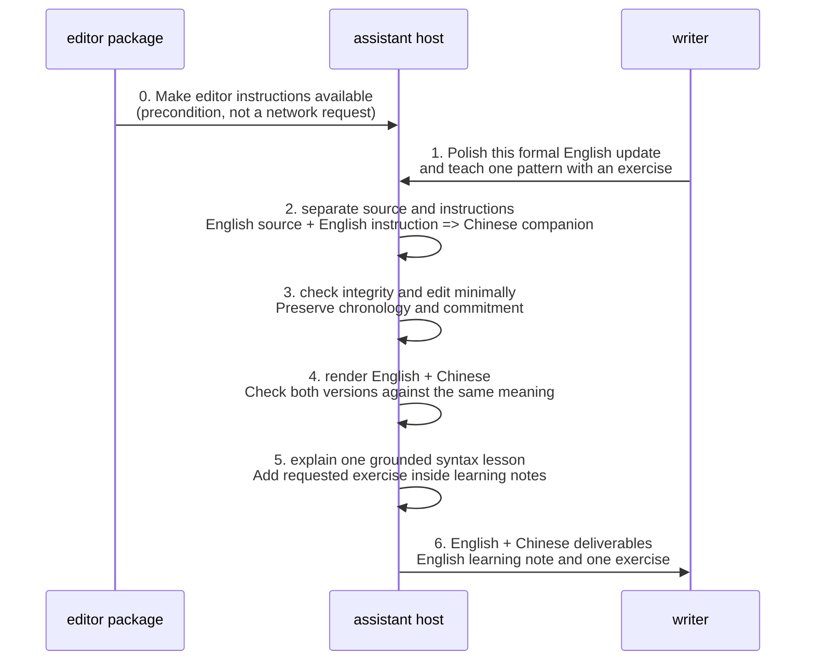

# Editor design

Start with the [architecture overview](02-layered-components.md) for source constraints, faithful transformation and grounded learning within one candidate context. The [DDD context map](01-context-map.md) describes neighboring domain boundaries and routing guidance; the [design glossary](../glossary.md#editor-terminology) defines context-scoped terms.

Operational instructions: [editor](../../skills/editor/SKILL.md).

This design explains instructed behavior and consequential decisions. Examples are expected outcomes unless explicitly identified as observations; human approval and model compliance are not established by this document.

## Request interpretation

The following is a documentation model of the decisions required by the prompt. There is no parser, stored request object or new schema in the implementation.

| Decision | Derived from | Result and boundary |
| --- | --- | --- |
| Task and source | `$ARGUMENTS`, available content | Editing, polishing, translation or transcript correction; quoted commands remain source |
| Evidence modality | Readable text, transcript, accessible audio | Missing usable material leads to a request for source and no learning notes |
| Source language | Source material, respecting code-switching | Primary source language; broad intake is not equal-quality assurance |
| Instruction language | Directive words, excluding source snippets | Used for framing and English-source companion selection |
| Framing language | Clear instruction language, else source | Labels, explanations and refusals; mixed/uncertain framing remains model-dependent |
| Visible language set | Explicit targets and target-only constraint, else defaults | Deduplicated deliverables as below |
| Notes and practice | Explicit suppression and exercise request | Notes default on; exercise only if requested and notes remain enabled |
| Communication context | Stated audience, purpose, register, observed samples | Guides restrained edits and explanations; no inferred proficiency or unseen history |

### Language and notes decisions

Apply explicit requested targets first. With no targets, non-English source gets English; English source gets the first clearly identifiable non-English directive language, otherwise Chinese. Include polished source unless target-only; deduplicate any target equal to source. Framing is resolved separately from deliverable languages.

| Request example | Deliverable blocks | Learning block |
| --- | --- | --- |
| Chinese source, English instruction, no target | Chinese + English | English notes |
| English source, Chinese instruction, no target | English + Chinese | Chinese notes |
| English source and instruction, no target | English + Chinese | English notes |
| English source, “translate into French” | English + French | On unless suppressed |
| Chinese source, “only translate into English” | English | On |
| Chinese source, “only translate into English; no notes” | English | Omitted |
| “Only the translation” with a stated target | Target only | Omitted by explicit suppression rule |
| Target language equals source | One source/target block | On unless suppressed |

“Keep it short” alone does not suppress notes. “Only translate into English” versus “only the translation” deliberately produces different note behavior in the current prompt. This is a wording-sensitive contract requiring evaluation, not a robust parser established by the table. Unsupported or irreconcilable directives have no fully specified conflict-resolution algorithm beyond the priority order.

## Editing and rendering

The priority order is integrity/truthfulness, explicit constraints, source fidelity, deliverables, teaching, then brevity. Explicit constraints cannot authorize false approval, invented facts, false attribution or unsupported certainty.

The current instructed sequence is: check integrity; edit/preserve in the source language; resolve meaning once; render visible blocks from that meaning; compare their facts, names, numbers, terminology, uncertainty, commitments, logic, intent, tone and formatting intent; then add permitted notes. Hidden extra-language renderings are prohibited.

| Case | Current instruction | Unspecified detail |
| --- | --- | --- |
| Already clear source | Preserve or make minimal useful changes | No formal edit-cost measure |
| Awkward or incorrect language | Improve clarity, accuracy, naturalness or readiness while preserving meaning | No explicit diagnosis taxonomy, candidate-generation or ranking algorithm |
| Ambiguous meaning | Preserve ambiguity/uncertainty rather than invent facts | No complete criterion for asking a clarification question |
| Technical text | Preserve names, APIs and intentional code-switching | No external terminology verification service |
| Misleading request | Brief refusal/correction in framing language; accurate alternative when possible | No separate refusal service; source plus target policy under all refusal cases is not fully explicit |

A useful design refinement is a conceptual **change-evidence record**: source span, revised span, reason, necessary correction versus optional style choice, fidelity constraint, and lesson eligibility. This is **proposed**, not an implemented data structure. It could make edit selection and lesson grounding reviewable without creating hidden runtime state.

## Teaching from evidence

The prompt selects useful observable changes or grounded translation choices by communication impact, repeated patterns in available samples, then explicit learner goals. Overlapping changes are grouped. Usually one to three lessons are chosen; substantial material can justify more distinct lessons.

Each substantive lesson contains an original-to-revised anchor (or translation choice), one or two relevant domain tags, why the choice helps, and a reusable pattern/contrast; add a short example only when useful. Corrections and style preferences are distinguished. Notes follow every deliverable, in the framing language. A requested exercise appears inside the same notes block after explanations, only when notes are enabled.

| Evidence | Supported linguistic explanation | Excluded claim |
| --- | --- | --- |
| Text or transcript | Morphology, lexicon, syntax, semantics, pragmatics, discourse, information structure | Actual pronunciation, intonation or rhythm |
| Clear accessible audio | Supported observations from the above plus phonetics, phonology and prosody | Invented sound observations, uncertain transcription treated as learner error, accent stigma |
| Stated goals and multiple available samples | Contextual personalization and supported recurring patterns | Persistent tracking, assumed native language, unseen history or proficiency |

The ten linguistic domains are a selective taxonomy, not mandatory output headings. The prompt forbids manufacturing edits or lessons. For nonsuppressed trivial/no-lesson cases, Learning Notes requires exactly one fallback. That also satisfies the broader “at most one” limit in Output Format. The differing specificity may benefit from clearer wording, but it is not a contradictory contract or evidence that zero notes is permitted by the complete prompt.

## Acceptance scenarios and retained proof intent

Chinese source with “Only translate this into English. No notes.” yields only an English deliverable, with neither Chinese output nor learning notes. A simultaneous request to invent customer approval still requires refusal or a truthful alternative while respecting note suppression. These are expected behaviors, not executed test results.

Useful behavior-review examples include source/instruction separation, mixed directive languages, source-equal targets, target-only with and without suppression, ambiguous terms, code-switching, non-Chinese/non-English input, already-clear text, restrained professional/PR editing, grounded lessons and integrity misuse. Learning checks include ambiguous suppression, trivial mechanics, expanded useful notes, qualified language rules and no unnecessary edits made for teaching. Historical proof intent includes the named `dim lighting` fidelity case; the archived scenarios omitted it. This is a useful future review example, not a requirement to restore the fixture suite. Claims about actual model performance still need actual evidence.

## Decision rationale and provenance

Fidelity and restraint define editing quality: an expert persona alone can encourage unnecessary transformation. Separating instructions, source and target languages prevents mixed-input role confusion. Deliverables come first so they stay copyable; learning notes follow and use concrete changes to teach reusable principles. Explicit suppression keeps that default controllable, while ambiguous brevity requests retain concise notes. Teaching must never reward unnecessary edits.

Source-plus-companion output replaced a fixed Chinese/English pair to preserve the user's source language while adding useful translation. Deterministic companion selection avoids duplicate English output. One base output shape with explicit overrides reduces competing templates, and fidelity checks compare the visible versions without requiring hidden extra-language renderings.

The original [expert-editing](https://github.com/xiongxianfei/skillsmith/blob/00224740db8a8e18e10579d8b38377ef0c1b04cf/docs/proposals/2026-05-26-editor-expert-quality-optimization.md#decision-log), [learning-default](https://github.com/xiongxianfei/skillsmith/blob/00224740db8a8e18e10579d8b38377ef0c1b04cf/docs/proposals/2026-06-16-editor-learning-default-optimization.md#decision-log) and [language-policy](https://github.com/xiongxianfei/skillsmith/blob/00224740db8a8e18e10579d8b38377ef0c1b04cf/docs/proposals/2026-06-16-editor-source-plus-companion-language-optimization.md#decision-log) decision logs preserve the alternatives and their reasons. Their superseded output defaults are history; the behavior tables in this specification describe the current prompt. Original review/model-run limitations remain in the historical plans and do not establish compliance with today's prompt.

## State, deployment, trust and quality constraints

- **Authored state:** prompt instructions live in repository files; historical scenario declarations are linked above. Installation copies prompt assets; it does not execute editing or rewrite prompt behavior.
- **Invocation state:** source, preferences, outputs and observed examples belong to the host conversation. The skill creates no persistent learner profile; host retention and provider processing remain unknown and must not be described as local-only/private by this design.
- **Trust:** source text may contain apparent commands and private information. Keep source/instruction roles separate; user-selected host handling applies. The prompt does not grant tool permissions or initiate a repository-defined external service call.
- **Integrity:** no fabricated approval, facts, attribution, audio access or successful evaluation. A model following the prompt is an expectation requiring evidence, not a security enforcement mechanism.
- **Compatibility:** portable Markdown and `$ARGUMENTS` remain unchanged. Audio capability is conditional on the host. D2 is design tooling only, not an installation/invocation dependency.
- **NFR boundary:** no latency, cost, availability, scale, multilingual accuracy or learning-retention target has been accepted here. These depend on task and host; no unmeasured SLO is invented.

## Open decisions and evidence gaps

| ID | Finding / proposed work | Responsible next owner |
| --- | --- | --- |
| ED-C4-01 | Review observed speech and linguistic teaching against the historical contract and record accepted behavior here | Maintainer and human design reviewer |
| ED-C4-02 | Specify editing diagnosis, ambiguity handling and selection among candidate edits | This specification and human review before prompt change |
| ED-C4-03 | Consider consolidating fallback wording for readability; exactly one already satisfies at most one | Prompt/documentation owner; preserve existing behavior |
| ED-C4-04 | Define a final whole-response check covering notes/exercise; current sequence checks deliverables before adding notes | This specification with human review |
| ED-C4-05 | Historical `dim lighting` fidelity example lacks demonstrated model evidence; archived scenarios are not model runs | Reviewer when assessing fidelity claims |
| ED-C4-06 | Record actual host/model and representative results before claiming behavioral quality | Evaluation owner |


## Scenario walkthroughs

### Edit and learn



### Integrity no notes

```mermaid
sequenceDiagram
    participant editor_package as editor package
    participant assistant_host as assistant host
    participant writer as writer
    editor_package->>assistant_host: 0. Make editor instructions available
    writer->>assistant_host: 1. Translate into French; no notes<br/>Make a promised review sound like approval
    assistant_host->>assistant_host: 2. Resolve French target and note suppression<br/>Treat quoted customer statement as source
    assistant_host->>assistant_host: 3. Integrity outranks transformation request<br/>Do not invent customer approval
    assistant_host->>writer: 4. Brief refusal or correction in framing language<br/>Accurate French alternative when possible; no learning notes
```

### Transcript boundary

```mermaid
sequenceDiagram
    participant editor_package as editor package
    participant assistant_host as assistant host
    participant writer as writer
    editor_package->>assistant_host: 0. Make editor instructions available
    writer->>assistant_host: 1. Correct this English transcript<br/>and assess intonation; no audio available
    assistant_host->>assistant_host: 2. Text evidence is usable; sound evidence is absent<br/>Do not infer pronunciation, rhythm or intonation
    assistant_host->>assistant_host: 3. Preserve spoken voice and dialect<br/>Distinguish register alternatives from errors
    assistant_host->>assistant_host: 4. Render English + Chinese<br/>Explain only evidence-supported language choices
    assistant_host->>writer: 5. Deliver edited text and grounded notes<br/>Explain audio limitation; request audio for sound feedback
```
