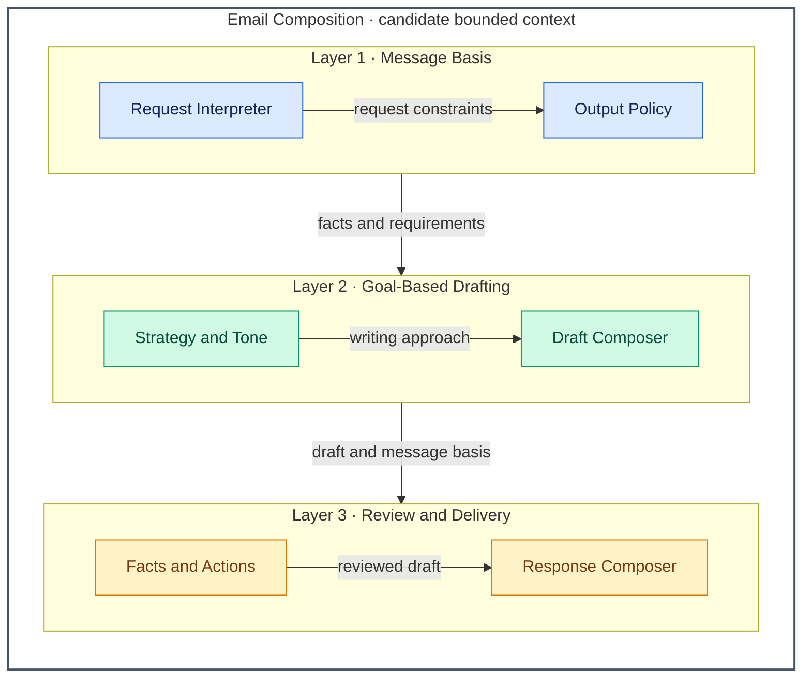

# Email Writer — Architecture Overview

**Instruction-aligned view:** the [email-writer skill](../../skills/email-writer/SKILL.md) turns supplied facts and a communication goal into a concise, actionable workplace email. It can draft a new message, reply, or tighten an existing email while preserving facts and intent. The output is a copyable draft with only the commentary and variants permitted by the request.

Components below are logical prompt responsibilities, not implemented services. The numbered layers are capability groups, not deployment tiers. Factual limits and output preferences constrain drafting, review and delivery throughout.

## Architecture Overview

Arrows carry information or constraints from provider to consumer. Group-level connections summarize the information shared by their components; the draft travels with its supplied facts and requirements so review can check it against them. No arrow represents sending an email.

## Layers

| # | Layer | Responsibility | Components |
| --- | --- | --- | --- |
| 1 | Message Basis | Establish the recipient, goal, supplied facts and missing essentials; resolve language, commentary and draft-count requirements. | Request Interpreter; Output Policy |
| 2 | Goal-Based Drafting | Choose an approach suited to the goal and audience, then organize known facts into a message with a clear action. | Strategy and Tone; Draft Composer |
| 3 | Review and Delivery | Check the draft against supplied facts and requirements, correct issues, and present copyable content with permitted commentary. | Facts and Actions; Response Composer |

## Contexts–components

**Email Composition** is one candidate bounded context: recipient, communication goal, supplied facts, commitments and requested actions form one message model. Drafting and review operate on that same model. Requests, complaints and updates select different writing strategies; they do not establish separate contexts or services.

| Context | Component | Layer | Responsibility |
| --- | --- | --- | --- |
| Email Composition | Request Interpreter | 1 · Message Basis | Identify recipient, goal, facts, existing draft and any supplied deadline. Ask a focused question or use a clear placeholder for essential unknowns; omit optional unknowns and unnecessary deadlines. |
| Email Composition | Output Policy | 1 · Message Basis | Resolve email language, requested translations, commentary, tips and variants. Honor one-draft and email-only constraints, and any supplied company style or signature convention. |
| Email Composition | Strategy and Tone | 2 · Goal-Based Drafting | Select the goal-specific approach silently: lead with the ask, decision, issue or key change as appropriate. Adapt tone to the audience, defaulting to polite-neutral; organize facts without inventing reasons, fixes or commitments. |
| Email Composition | Draft Composer | 2 · Goal-Based Drafting | Compose subject, greeting, summary, necessary details, closing action, sign-off and signature placeholders. Make who does what clear, include timing only when supplied or explicitly marked unknown, and preserve an existing draft's facts and intent. |
| Email Composition | Facts and Actions | 3 · Review and Delivery | Silently check the point, action, deadline provenance, consistent names, brevity and attachment claims against supplied information. Fix problems before showing the draft; unresolved essentials remain questions or explicit placeholders. |
| Email Composition | Response Composer | 3 · Review and Delivery | Present the copyable email first. Add the permitted strategy line and adjustment offer, briefly identify material edits when reviewing a draft, and include requested tips or justified variants within the output policy. |

## Boundaries and sources

- **Strategy does not supply facts:** a delay strategy cannot invent a revised date or fix; a decline cannot invent a reason or alternative. Names, amounts, commitments and signature details must be supplied or left as placeholders. The [strategy rules](../../skills/email-writer/SKILL.md#writing-strategy) own the goal-specific choices.
- **Output is request-sensitive:** use the requested language, otherwise the pasted email's language, otherwise the request language. Translations require a request. Routine messages get one draft; two variants are reserved for sensitive or high-stakes messages, with potential tone trade-offs rather than promised recipient reactions. An explicit one-draft or email-only request still gets one copyable email.
- **Commentary is conditional:** email-only or no-commentary requests suppress explanations and offers. Otherwise include one strategy line and an adjustment offer; tips require a request. When reviewing an existing draft, identify only the one or two changes that matter most, subject to commentary suppression.
- **Attachment claims require support:** mention a file as attached only when the user confirms it or available tools verify it. Otherwise use `[attach file before sending]` and, when commentary is allowed, flag the reminder outside the email. The [pre-send checklist](../../skills/email-writer/SKILL.md#pre-send-checklist) is an instructed review, not an automated attachment verifier.
- **Drafting ends at delivery to the user:** this skill establishes no account access, sending capability or background workflow. Its [templates](../../skills/email-writer/SKILL.md#templates) are inline instructions, not separate resource components or services. No external capability is required by this architecture.

The [subject entrypoint](README.md) links the owning instructions. This refinement explains their responsibilities without changing skill behavior or claiming observed model compliance or independent approval.
