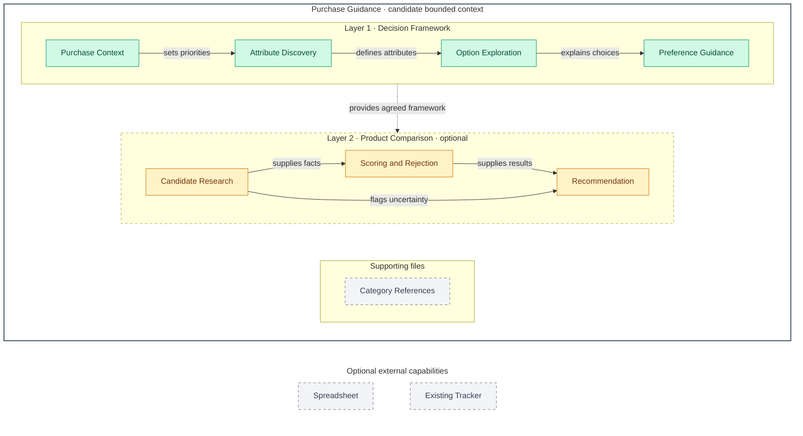

# Purchase Comparison — Architecture Overview

**Instruction-aligned architecture:** a personalized decision framework is the primary outcome; comparing named products is an optional follow-up. The [skill instructions](../../skills/purchase-comparison/SKILL.md) implement this guidance policy. Components describe logical responsibilities, not implemented services.

**Input:** a purchase category, such as keyboard, plus available use case, budget and constraints. **Primary output:** relevant attributes, recommended importance weights with reasons, options with recommended suitability scores and trade-offs, and an opportunity to adjust preferences. Exact product models are not required to complete this output.

## Architecture Overview

Arrows describe information passed between responsibilities; labels identify the contribution. The numbered bands group capabilities, not deployment tiers or mandatory execution phases. The dashed connection marks an optional continuation.

## Layers

| # | Layer | Responsibility | Components |
| --- | --- | --- | --- |
| 1 | Decision Framework | Identify the purchase context, brainstorm relevant attributes and recommended weights, recommend option suitability scores with reasons, and help the user personalize the framework. This is a complete useful outcome without candidate research or ranking. | Purchase Context; Attribute Discovery; Option Exploration; Preference Guidance |
| 2 | Product Comparison (optional) | Apply the agreed framework to named products when requested; research evidence, evaluate candidates and explain recommendations. | Candidate Research; Scoring and Rejection; Recommendation |

Category References support attribute and option exploration. They are bundled files outside the numbered layers, not default preference profiles. Spreadsheet and Existing Tracker are conditional external capabilities; neither is supplied by the skill. Invisible Mermaid links only position these supporting boxes.

## Contexts–components

**Purchase Guidance** is one proposed bounded context: category, use case, attributes, options and preferences form a shared decision model. Optional product comparison consumes that same model; it does not establish a second context. The skill's directory and invocation name remain `purchase-comparison`.

| Context | Component | Layer | Responsibility |
| --- | --- | --- | --- |
| Purchase Guidance | Purchase Context | 1 · Decision Framework | Identify the category, intended use, budget and constraints from available information; ask focused questions for material gaps. Distinguish the category, such as keyboard, from a specific model. |
| Purchase Guidance | Attribute Discovery | 1 · Decision Framework | Brainstorm attributes worth considering, explain their importance and recommend initial importance weights with reasons and explicit use-case assumptions. Suggestions are not treated as accepted user preferences. |
| Purchase Guidance | Option Exploration | 1 · Decision Framework | Explore choices or numeric ranges for each attribute and recommend suitability scores with reasons, benefits, drawbacks and explicit assumptions. Adapt category references and check ranges for gaps or overlap. |
| Purchase Guidance | Preference Guidance | 1 · Decision Framework | Help the user add or remove attributes, revise suggested weights and express preferred options or exclusions. Keep recommendations distinguishable from adopted preferences. Respect existing values and user requests to leave scores blank; explicit adoption is required before suggestions become ranking inputs. |
| Purchase Guidance | Candidate Research | 2 · Product Comparison · optional | Record exact models and relevant specifications with sources and verification status; prefer official specifications, mark memory/review facts unverified and leave unknown values blank. |
| Purchase Guidance | Scoring and Rejection | 2 · Product Comparison · optional | Apply user-adopted attribute weights and option scores to candidate facts. Flag missing inputs rather than inventing defaults; a matched `X` rejects a candidate. Keep raw values separate from calculated scores. |
| Purchase Guidance | Recommendation | 2 · Product Comparison · optional | Explain candidate results, decisive attributes, unverified information and aspects requiring hands-on testing. |

## Notes and sources

- **Weight and score are different:** an attribute weight expresses importance; an option score expresses suitability. The user resolved the option-score decision: recommend both, normally using weights 1–5 and scores 0–5. These are suggestion scales, not restrictions on user values; preserve user-provided values and label suggestions separately from adopted preferences.
- **Policy change applied to instructions:** proactively recommend both weights and scores with contextual reasons, allow completion with a decision framework, and make model comparison optional. This replaces request-only suggestions and the comparison-sheet-first workflow; the user still owns adoption, revisions and exclusions.
- **Keyboard walkthrough:** establish the intended use and budget; discuss attributes such as layout, connection and sound; recommend importance weights under stated assumptions; recommend option scores and explain trade-offs; let the user revise the resulting guide. No named keyboard or ranking is required. A later comparison request can reuse the adopted framework.
- Category references: [keyboard](../../skills/purchase-comparison/references/keyboard.md), [mouse](../../skills/purchase-comparison/references/mouse.md), [mousepad](../../skills/purchase-comparison/references/mousepad.md). These supply attribute and option starting points, without user scores. Weight and score recommendations depend on context, not universal category defaults.
- Existing scoring uses the sum of weight × score and percentages relative to `5 × sum(weights)`. Negative weights, scores outside the usual 0–5 range and a zero denominator leave edge cases unspecified. The skill preserves the weighted sum and flags normalization as unresolved for these cases; it does not invent a replacement percentage or divide by zero.
- Spreadsheet generation requires a request and available capability. Updating `tblItems` requires an existing accessible tracker. The skill does not purchase products. Detailed spreadsheet requirements remain in the [current instructions](../../skills/purchase-comparison/SKILL.md#sheet-layout-always-the-same).

This describes current instructions and candidate logical boundaries, not observed model compliance or independent approval. Return to the [subject entrypoint](README.md).
