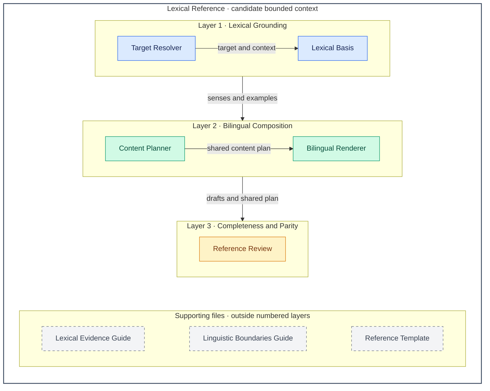

# Vocabulary Mastery — Architecture Overview

**Instruction-aligned view:** the [vocabulary skill](../../skills/vocabulary-mastery/SKILL.md) turns one English word or fixed expression into two independently complete references: English first, then Simplified Chinese. A shared lexical basis and content plan keep both versions aligned. Missing or unrelated multiple targets require clarification before a full entry.

Components below are logical prompt responsibilities, not implemented services or host internals. The numbered layers are capability groups, not deployment tiers. Supporting files are actual bundled resources outside those layers; this is not a formal C4 component model.

## Architecture Overview

Arrows carry information from producer to consumer. They show the shared basis of the two references, not separate English and Chinese processing systems. Invisible links only position the supporting files. Resource loading conditions are specified below the tables.

## Layers

| # | Layer | Responsibility | Components |
| --- | --- | --- | --- |
| 1 | Lexical Grounding | Resolve one target and establish supported senses, word classes, pronunciation distinctions, usage and uncertainty shared by both references. | Target Resolver; Lexical Basis |
| 2 | Bilingual Composition | Plan the full learning content once and render two independently complete versions using the required template. | Content Planner; Bilingual Renderer |
| 3 | Completeness and Parity | Check each version against the shared plan and compare factual and instructional content across languages; correct or qualify discrepancies. | Reference Review |

## Contexts–components

**Lexical Reference** is one candidate bounded context: target senses, examples, linguistic dimensions and recall concepts share lexical evidence and bilingual parity rules. English and Chinese are two presentations of the same reference model, not separate contexts. The ten dimensions organize content within that model; they do not require ten architectural components.

| Context | Component | Layer | Responsibility |
| --- | --- | --- | --- |
| Lexical Reference | Target Resolver | 1 · Lexical Grounding | Identify one word or fixed expression, supplied context, intended sense, purpose and language-variety preference. Ask for a target or selection when absent or when several unrelated targets are given. |
| Lexical Reference | Lexical Basis | 1 · Lexical Grounding | Prioritize contextual meaning or select up to three supported major senses/word classes. Keep homographs and pronunciation distinctions separate; establish grammar frames, original examples and uncertainty once. |
| Lexical Reference | Content Planner | 2 · Bilingual Composition | Organize all ten ordered dimensions, paired examples, two or three knowledge connections, exactly three recall concepts with answers and necessary qualifications. Weak word-specific evidence calls for honest limits, not fabricated properties. |
| Lexical Reference | Bilingual Renderer | 2 · Bilingual Composition | Read the required template, complete English first, then complete Simplified Chinese from the same plan. Localize explanations, headings, questions and answers; retain original English lexical objects, examples and IPA, adding faithful Chinese translations of examples. |
| Lexical Reference | Reference Review | 3 · Completeness and Parity | Check both parts independently for coverage and matched questions/answers. Compare senses, pronunciation, examples, connections and caveats; rewrite inconsistencies or qualify unsupported details. Mark interrupted output incomplete and continue when the host permits. |

## Supporting files and boundaries

- **Lexical Evidence Guide:** [lexical-evidence.md](../../skills/vocabulary-mastery/references/lexical-evidence.md) supports Lexical Basis when ambiguity, homographs, regional variation, doubtful morphology, unusual usage or coinage requires extra care. It supplies evidence rules, not dictionary or corpus data.
- **Linguistic Boundaries Guide:** [linguistic-boundaries.md](../../skills/vocabulary-mastery/references/linguistic-boundaries.md) supports Content Planner when dimensions are easily conflated or word-specific evidence is weak. Its loading is conditional; its examples are not properties to assign to every word.
- **Reference Template:** [full-reference-template.md](../../skills/vocabulary-mastery/assets/full-reference-template.md) is required before every complete entry and supplies Bilingual Renderer with the canonical layout. Instructions and template remain English-only; Chinese is generated output. Reviewer-only evaluation cases stay outside the invocation view.
- **Complete means independently usable:** each part has its own overview, all ten dimensions, two or three connections, exactly three questions with aligned answers and accuracy notes when needed. Chinese is not a summary or “see above” reference. Output limits do not authorize silent omission. The [subject design](README.md#two-independently-complete-outputs) retains the detailed parity criteria.
- **Evidence limits travel with the content:** a supplied sentence establishes intended context, not lexical attestation. Coinages cannot acquire invented standard meanings or pronunciations. Reference IPA and illustrated prosody do not establish how a learner actually spoke; no lookup, audio playback or verification may be claimed without actual support.
- This view introduces no external lexicon service, persistent learner record or automated verification engine. Full-directory access and sufficient host output capacity remain practical constraints. Reading the files or rendering this graph does not demonstrate linguistic accuracy or host compliance.

The [subject design](README.md) owns detailed contracts and scenarios; [skill instructions](../../skills/vocabulary-mastery/SKILL.md) own operational behavior. This refinement changes the explanation, not the fixed bilingual reference contract or its routing boundaries.
