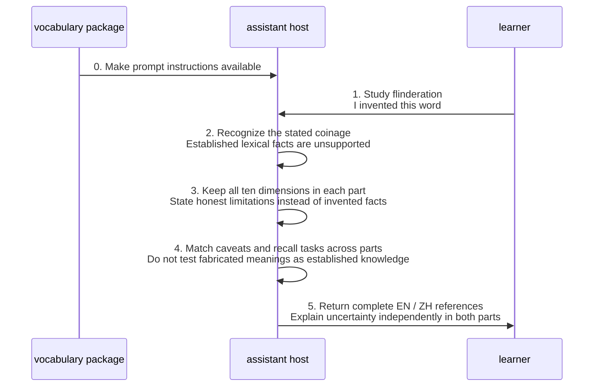
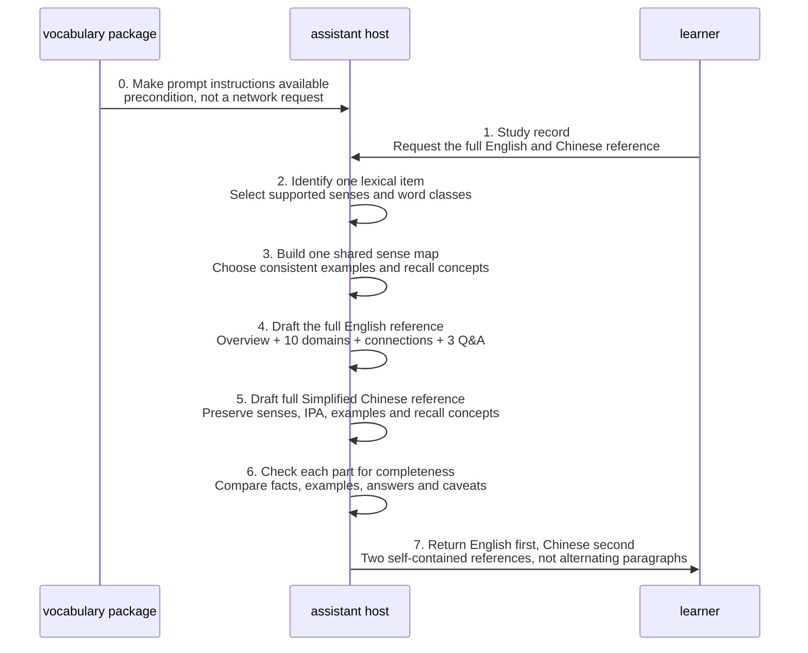
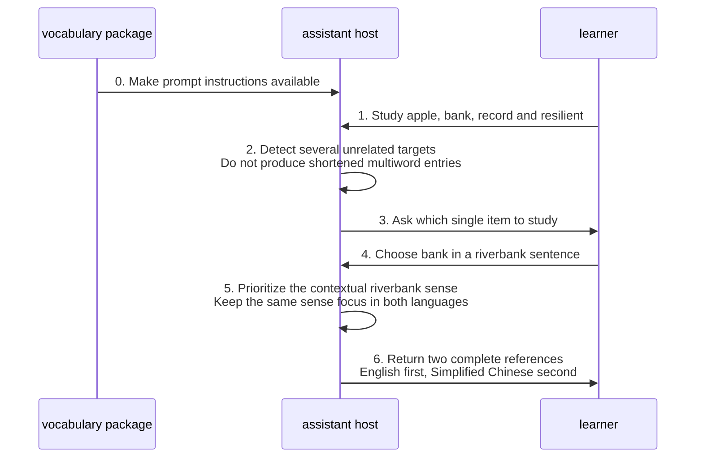

# Vocabulary mastery design

Start with the [architecture overview](02-layered-components.md) for lexical grounding, bilingual composition and parity review, with supporting files outside the numbered capability groups.

Operational instructions: [vocabulary-mastery](../../skills/vocabulary-mastery/SKILL.md).

This design explains instructed behavior and consequential decisions. Examples are expected outcomes unless explicitly identified as observations; human approval and model compliance are not established by this document.

## Concrete information flow

The implementation instructs the host to perform this logical flow:

**Resolve one target → build a shared sense map and examples (loading targeted references when needed) → load the full-reference template → complete English reference → complete Chinese reference → check each part and compare parity → return both.**

The following information structure explains that flow. It is not an implemented JSON schema, persistent record, exposed reasoning transcript or new tool call.

| Logical information | Contents | Used by |
| --- | --- | --- |
| Target context | Headword/expression, supplied sentence, requested sense, learner goal, BrE/AmE preference | Sense selection and examples |
| Shared lexical basis | Selected senses/word classes, qualified pronunciation, grammatical frames, original examples, uncertainty | Both complete references |
| Dimension coverage | Ten ordered observations; explicit absence/limits where distinctive properties are unsupported | English drafting and Chinese explanation |
| Learning connections | Two or three links across linguistic dimensions | Knowledge Connections in both parts |
| Recall alignment | Exactly three concepts, corresponding questions and matching answers | Retrieval sections in both parts |
| Parity criteria | Same senses, IPA, observations, examples, connections, retrieval concepts and caveats | Independent completeness and cross-part checks |

The prompt explicitly directs sense mapping, conditional resource loading, a common content plan, and completeness/parity checks. The remaining rows make their information dependencies visible; they do not assert actual persisted structures inside a model.

## Skill directory resources and loading boundaries

This refactor preserves the **publicly selected** full bilingual ten-domain reference contract. It changes the distribution/maintenance interface from a standalone prompt to the full [Agent Skills](https://agentskills.io/specification) directory. An agent with full-directory access is needed to follow file-loading instructions reliably.

| Bundled file | Load condition | Authority and limit |
| --- | --- | --- |
| [Entry point](../../skills/vocabulary-mastery/SKILL.md) | Every invocation | Sole owner of required behavior, ten-domain order, source integrity and two-part output invariants |
| [Full-reference template](../../skills/vocabulary-mastery/assets/full-reference-template.md) | Before every complete entry | Canonical heading/field layout; extraction supports maintenance, not reduced context use |
| [Lexical evidence](../../skills/vocabulary-mastery/references/lexical-evidence.md) | Ambiguous pronunciation/sense, homographs, coinage, regional variation or weak morphological/attestation evidence | Additional epistemic checks, not a lookup or provenance guarantee |
| [Linguistic boundaries](../../skills/vocabulary-mastery/references/linguistic-boundaries.md) | Confusable linguistic dimensions or domains with weak word-specific evidence | Guidance for honest dimension-specific illustrations, not permission to invent claims |
| [Review cases](../../skills/vocabulary-mastery/evals/review-cases.md) | Maintainer evaluation only | Expected outcomes, not actual model test results |

No `scripts/`, external lexicon, network service, persistence store, or model-level resource-read verification is introduced. The host's actual resource-loading behavior must be evaluated on a supported host; a valid Markdown link does not prove that an agent read it.

The template requires all ten domains in both parts and exactly three matched recall questions/answers. The source entrypoint also requires marking an interrupted output as **incomplete** rather than silently shortening the Chinese section. Completion under output-budget limits remains to be tested, not assumed.

## Input and routing decisions

| Input condition | Current instructed behavior | Evidence / limitation |
| --- | --- | --- |
| No target | Ask for one English word or lexical expression; do not emit empty profiles | Workflow 1; `vocabulary-no-input` |
| Several unrelated targets | Ask which one to study | Workflow 1; `vocabulary-multiple-unrelated-targets` |
| One expression such as `look up` | Treat the expression as one lexical item; honor its supplied meaning | `vocabulary-separable-expression` |
| A sentence establishing a sense | Prioritize that context in both versions | `vocabulary-bank-context-sense-parity` |
| No narrowing context | Distinguish up to three well-supported major senses or word classes | Workflow 2; homographs remain separate |
| Explicit BrE/AmE preference | Account for the requested variety; label confident reference IPA and qualify uncertainty | Workflow 1 and Linguistic Rules; no verification service specified |
| User-created coinage | Identify the evidence limit; retain ten sections without inventing established lexical facts | `vocabulary-coinage-evidence-boundary`; complete recovery strategy is not specified |
| Line-by-line bilingual formatting request | Preserve the selected skill's fixed two-part format | `vocabulary-conventional-fixed-two-part-contract`; this is unlike editor's configurable language contract |
| Ordinary proofreading, conversation tutoring or Anki export | Favor `editor`, `language-tutor` or `flashcard-generator` respectively | Routing guidance, not an implemented inter-skill API or automatic dispatch guarantee |

A fixed lexical expression is not equivalent to several unrelated words. The prompt does not provide a complete recognition algorithm for malformed input, non-English targets, or ambiguous phrase boundaries. Those remain limits, not invented error branches.

## Ten-dimension content design

Every row appears in both references, numbered in this order. Explanations aim for one to three substantive sentences per domain, with more depth only for meaningful complexity. An honest absence of a distinctive word-level property is valid content; an omitted domain or fabricated phenomenon is not.

| # | Dimension | Content responsibility | Boundary to preserve |
| --- | --- | --- | --- |
| 1 | Phonetics | Reference segments and articulation | Does not assess how the learner actually spoke |
| 2 | Phonology | Syllables, lexical stress and system contrasts | Distinct from sentence focus/intonation |
| 3 | Morphology | Real inflections/derivations and spelling changes | Do not infer historical roots from spelling alone |
| 4 | Lexicon | Collocations, chunks and lexical relations | Do not invent conventional expressions or frequency evidence |
| 5 | Syntax | Word class, countability, complements and grammatical frames | Preserve sense-specific grammatical behavior |
| 6 | Semantics | Differentiated senses, contextual meanings and contrasts | Do not collapse homographs or Chinese glosses |
| 7 | Pragmatics | Social intention, register and context | A word need not have a special speech act |
| 8 | Discourse | Coherence/reference across sentences or turns | Distinct from isolated sentence grammar |
| 9 | Information Structure | Given/new information, topic and contextual focus | Specify the context making focus meaningful |
| 10 | Prosody | Sentence prominence, rhythm and intonation illustrations | Reference illustration is not observed learner production |

Knowledge Connections then provides two or three cross-domain links. For example, a reference can connect a selected word class with its grammatical frame and usage distinction. No dictionary, corpus, recording or pronunciation service is invoked by the prompt; claims of verification or playback are prohibited when unsupported.

## Two independently complete outputs

Each part contains:

1. Word Overview: headword, selected word classes/senses, qualified BrE/AmE pronunciation when known, context focus.
2. All ten numbered dimensions with substantive explanation and useful natural examples or honest limitations.
3. Two or three Knowledge Connections.
4. Exactly three Recall Prompts and three corresponding Answers.
5. Accuracy Notes when needed, carrying the same qualifications in both parts.

English is completed before Chinese. The Chinese part localizes its title, section names, labels, explanatory prose, questions and answers. English lexical objects remain intact where needed: headword, cited forms, frames and original sample sentences; IPA is preserved. Each retained English example receives a faithful Chinese rendering. Chinese explanations are full rather than abridged, and neither part relies on “see above.”

| Parity check | Expected relation | Example failure |
| --- | --- | --- |
| Sense identity | Same selected meaning and word class | Contextual riverbank switches to financial bank in Chinese |
| Pronunciation | Same qualified IPA and distinctions | One homograph is merged into another pronunciation |
| Examples | Same original English samples plus Chinese translations | Chinese replaces the sample with an unrelated sentence |
| Coverage | Ten domains and supporting sections independently present | Chinese becomes a summary or omits prosody |
| Retrieval | Same three concepts, aligned answers | Chinese asks different questions or drops answers |
| Qualifications | Same uncertainty in each part's Accuracy Notes when needed | Caveat appears only in English or as a shared global note |

These are model-directed checks, not an implemented automated comparison engine. No fixed part-length ratio or exact textual translation is required; parity is factual and instructional.

## Scenarios and quality evidence

| View / historical scenario | What the design demonstrates | Evidence status |
| --- | --- | --- |
| [Complete reference](#complete-reference) | `record`: shared sense map, full EN/ZH outputs, parity check | Derived from `vocabulary-record-two-complete-references` and archived recall scenarios; not an execution log |
| [Target clarification](#target-clarification) | Multiple targets → choose one → contextual `bank` reference | Composed walkthrough from archived multiple-target and bank scenarios; follow-up exchange is illustrative |
| [Coinage boundary](#coinage-boundary) | `flinderation`: required structure with honest evidence limits | Archived coinage scenario plus shared recall/accuracy rules; exact limited-content output remains underspecified |

Additional archived scenarios address `lead` homographs, `unhappiness` morphology, `apple` weak word-level dimensions, `look up` syntax, indirect triggering, independently readable Chinese, text-only pronunciation boundaries and non-triggers. These are written expected behaviors, not proof of accuracy, effective retrieval practice or long-term retention.

Sequence self-messages represent prompt-directed logical activities inside the external host. They do not expose model internals, create separate components or guarantee a deterministic execution order.

## State, trust, deployment and constraints

- **Authored state:** English-only instructions in `SKILL.md` and its two conditional references; a required static layout under `assets/`, plus reviewer-only cases under `evals/`. The generated Chinese reference is output, not a separately maintained Chinese prompt.
- **Invocation state:** target, sense map, examples, draft references and questions belong to the current host interaction. No Skillsmith learner profile, score history, spaced-repetition schedule or progress database is implemented.
- **External execution:** installation must make the full skill directory accessible; pasting `SKILL.md` alone is not equivalent. Host file-loading capabilities, context limits, latency, inference cost, availability, authentication and retention policies are unknown. No local-only processing or privacy guarantee follows from a Markdown skill.
- **Accuracy:** preserve uncertainty and label supported variety distinctions. Reference pronunciation is not an assessment of the learner's actual speech. The skill does not establish an audio-assessment workflow merely by warning against unsupported sound claims.
- **Trust:** user sentences and invented terms are evidence to interpret, not independent authority for established lexical facts. The prompt does not fully specify hostile embedded-instruction handling; no security enforcement claim is made.
- **Quality tradeoff:** two full references favor independent usability over brevity. If output is interrupted, the prompt now requires labelling it incomplete and continuing when possible; this has not been demonstrated in a real host.
- **Non-functional boundary:** no measured accuracy, speed, cost, scale or learning-retention target is accepted here. D2 is documentation tooling only; product installation and invocation gain no dependency.

The shared development platform supports authoring, required-metadata validation, review and distribution outside the learner's request. Cross-skill lessons about evidence quality or bilingual consistency may improve that platform after assessment. This is not an implemented telemetry/training loop, and no platform service is drawn on the invocation path.

## Open design work

| ID | Gap / candidate refinement | Next owner |
| --- | --- | --- |
| VM-C4-01 | Review these observations and record the accepted behavior and constraints in this specification | Maintainer and human design reviewer |
| VM-C4-02 | Define support/confidence criteria for IPA, senses, morphology and regional claims; no source-verification mechanism exists here | Requirements and evaluation owners |
| VM-C4-03 | Test whether the host can identify and continue interrupted long-form bilingual output; the prompt's incomplete-output rule is not yet behaviorally verified | Evaluation owner |
| VM-C4-04 | Specify malformed-input, ambiguous-expression and non-English-input handling and the limits of unsupported coinage profiles; missing-target behavior already asks for a target | Maintainer and human reviewer of this specification |
| VM-C4-05 | Review rubric is now drafted under `evals/`; collect baseline vs revised model outputs and expert bilingual assessments before claiming improvement | Evaluation owner; preserve exact subject/model identity |
| VM-C4-06 | The user explicitly retained the ten-domain/two-version fixed contract for this revision; review conflicts and confirm the model follows it | Maintainer and evaluator |

These are proposals or unresolved decisions, not newly accepted requirements. Human architecture sign-off remains pending. The [repository instructions](../../AGENTS.md) describe validation and review; no catalog-wide completeness or successful learning claim is inferred from these views.

## Scenario walkthroughs

### Coinage boundary

### Complete reference

### Target clarification

