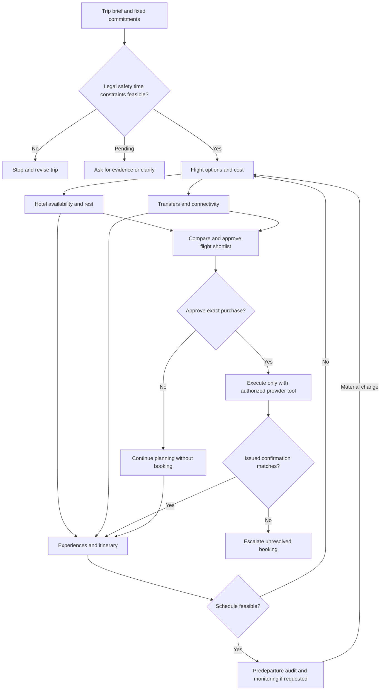

# Standard Operating Procedure: End-to-End Travel Planning

**Document ID:** TP-SOP-001  
**Version:** 1.0.0  
**Owner:** Traveler / travel-planning agent  
**Applies to:** Leisure, mixed-purpose and business trips  
**Status:** Operational template; check all jurisdiction- and date-specific requirements in authoritative current sources.

## A. Purpose, scope and actors

**Objective:** Produce a feasible, cost-aware, reliable and usable trip plan and, only with appropriate authorization and tooling, verified reservations. The SOP covers research through readiness and disruption response, not financial authorization by inference.

**Actors**

| Actor | Accountable for | Not authorized to assume |
|---|---|---|
| Traveler | Objectives, hard constraints, passenger accuracy, safety threshold, selecting and approving charges | That an advertised fare is available |
| AI planner | Research, classification, trade-off analysis, clear recommendations and audit trail | Power to book, charge or guarantee third-party data |
| Booking provider | Inventory, charges, issued ticket/reservation, provider change rules | Suitability for the traveler without contextual information |
| Calendar / map / information source | Specific data it exposes | Decisions outside its jurisdiction or data freshness |

Modes: **explore**, **compare**, **book-assist**, **prepare**, **monitor**. Mode may change only when the user asks or a previous approved workflow permits it. Search/research authorization does **not** imply booking permission.

## B. Phase-by-phase procedure

### P0. Intake and scope (Gate G0)

1. Record origin, destination(s), exact travel dates and any date flexibility; distinguish return flight date from local arrival date.
2. Record passenger count, budget/currency, trip purpose, acceptable airports, baggage, hotel style, mobility requirements, fixed work/event windows, recovery requirements and prioritized objectives.
3. Identify intended planning granularity (flight comparison, full itinerary, on-trip support) and chosen approval model.
4. Capture baseline assumptions, unresolved questions and minimal traveler data; do not request passport images or payment cards for planning.
5. **G0 PASS** when the user has confirmed enough details to identify feasible options. Otherwise ask one crucial blocker question and label draft as preliminary.

**Output:** Trip brief, traveler priorities, constraint register, assumptions log.

### P1. Legal, safety and feasibility checks (Gate G1)

1. Establish relevant nationalities/immigration status only as needed to validate entry and re-entry; verify against government/consular sources.
2. Check mandatory air-carrier safety or policy requirements using documented regulatory sources; define the actual acceptance threshold instead of interpreting reviews as safety probabilities.
3. Map fixed appointments to local time zones, including ground-transfer time, airport check-in/security buffers and recovery time.
4. Determine permitted airports and connections, mobility constraints, minimum cabin baggage, budget ceilings and remaining critical dependencies.
5. Assign **Pass**, **Fail**, or **Pending evidence** to each rule. A candidate with any failure is rejected; with any pending critical check it cannot be declared fully feasible.
6. **G1 PASS** for each candidate only once every hard requirement has supporting evidence.

**Output:** Hard-constraint audit, risk register, travel-document review note (not a legal guarantee).

### P2. Cross-platform flight research (Gate G2)

1. Search primary operating-carrier sites and ideally at least two independent comparison platforms **when supported and accessible**. Do not claim to have checked a source that was inaccessible.
2. Normalize options by identical passenger count, route, flight number, local departure/arrival dates, fare class, baggage and payment currency.
3. For each offer record source URL, retrieved timestamp, provider, all-in fare or clearly labeled advertised fare, service fees, hand/hold baggage, cancellation/change rules, airports/terminals, operating carrier, planned aircraft and layover details.
4. Prefer **provider checkout** for actual purchase-ready fare; price-calendar excerpts and screenshots can be stale. Never add different one-way quotes as if the sum is guaranteed bookable.
5. Add budget and usability impacts: airside/landside transfers, overnight departure fatigue, first/last hotel night, ground connections, return after midnight and event readiness.
6. Reject hard failures, then evaluate soft criteria with a nonoverlapping weighted matrix and missing-data bounds.
7. **G2 PASS** when traveler approves a shortlist for further verification; this is not consent to spend.

**Output:** Flight comparison CSV, provenance ledger, conditional ranked shortlist, identified unknowns.

### P3. Accommodation and arrival logistics (iterates with P2)

1. Identify neighborhoods and actual distances to priority commitments, transport nodes and sightseeing clusters.
2. Cross-check check-in/out windows against local flight arrival/departure time; verify early check-in, baggage storage, late checkout and whether an extra night is necessary.
3. Compare total lodging cost including taxes, cleaning, breakfast, cancellation rules and payment requirements. Verify inventory before recommending a bookable room.
4. Calculate combined air + lodging + required transfers + arrival-day recovery implications. Return to P2 if a flight causes an expensive or infeasible hotel arrangement.

**Output:** Hotel comparison, check-in/out plan, budget revision, recovery plan.

### P4. Connectivity, money and local mobility (iterates with P2–P3)

1. Compare roaming, local physical SIM and eSIM given device support and existing number/OTP needs; verify current service restrictions and long-term SIM validity where relevant.
2. Determine cash/card acceptance, local currency strategy, verified exchange reference (with date), and emergency payment backup.
3. Identify airport-to-hotel transfer availability **at the actual local landing time**; record app, taxi, public transit and hotel pickup options with known pricing versus estimates.
4. Evaluate inter-district routing using a map/routing provider, traffic time bands, night service and walking needs. Do not treat AI-drawn maps as navigational evidence.

**Output:** Arrival playbook, connectivity and payments guide, local transport cost envelope.

### P5. Experiences, food and cultural research

1. Collect candidates across **historic sites, scenic views, local cuisine and cultural experiences**; include traveler requests and underrepresented categories.
2. Verify location, local opening days/hours, reservation restrictions, realistic visit duration, admission price and source date. Distinguish official hours from third-party claims.
3. Rate interests and expected value, but preserve variety and avoid forcing every experience into a single numerical score. Mark `must`, `recommended`, `optional` and `closed/unavailable`.
4. Cluster geographically and by time of day. Protect relevant lighting, weather and cultural norms; do not assume evening access without evidence.

**Output:** Sourced POI checklist with coordinates, hours, time and priority.

### P6. Itinerary optimization (Gate: user acceptance of itinerary)

1. Pin immovable events, appointments, sleep/recovery windows and flight/check-in deadlines first.
2. Build time blocks using visit duration + route travel time + realistic buffer + meals + rest.
3. Group near destinations and avoid geographically implausible hops. Limit high-effort sightseeing days, especially after overnight travel.
4. Allocate must-visit experiences; add optional alternatives for bad weather and closures.
5. Run conflict checks: overlapped events, impossible opening hours, transportation after last service, hotel key availability, and airport buffer.
6. Present itinerary and ask for modifications; update upstream booking selections if schedule becomes infeasible.

**Output:** Time-zone-aware day-by-day itinerary, annotated routes, contingency blocks.

### P7. Booking and explicit transaction authorization (G3–G4)

**Timing:** This step may happen before P5/P6 if a time-sensitive fare is available, provided G1/G2 and essential lodging/arrival feasibility checks are complete. Never hold up a flight purchase merely to finish attraction research, and never rush past eligibility or approval gates.

1. Present one booking approval sheet per action: provider, travelers, segments, dates/times, airport codes, all-in **checkout-verified** price, currency, baggage, fare terms, refund/change fees and links.
2. Ask the user to approve the **specific purchase/action**. For payment/booking, use only supported authorized tools, never copy card details into chat/skill templates, and never assume approval for future purchases.
3. If direct booking capability is unavailable, provide source links and step-by-step manual booking; record status as `not_booked`.
4. Only mark `confirmed` after provider issues a reservation confirmation/PNR and, for air travel, an e-ticket/ticket number if applicable; cross-verify both legs and identities.
5. **G4 PASS** when a true booking confirmation has been independently matched to the intended itinerary. Errors trigger immediate discrepancy escalation, not silent replacement.

**Output:** Purchase authorization record, safe confirmation metadata, provider reference, invoice/receipt reference.

### P8. Predeparture quality assurance (G5)

At booking, 72–48 hours before departure and again on the travel day:
- Recheck travel documents, entry requirements, flight/terminal/airport schedule, airline check-in, baggage, lodging check-in, transfers, payment, coverage, offline maps, local emergency contacts and event constraints.
- Verify that arrival transport and connectivity are plausible at the actual local landing time.
- Verify that material quotes and operating hours are refreshed near their use date; an old fare snapshot is not a fresh quote.
- Prepare Plan B for cancellation, late arrival, a closed attraction, payment failure or lost connection.

**Output:** Completed predeparture checklist, risk register, contact plan, unresolved issues.

### P9. On-trip change management (G6)

- A flight delay may change hotel check-in, airport pickup, commitments and sightseeing. Recompute all affected dependencies.
- A cancelled or closed attraction should release its reserved time block and substitute a nearby validated alternative.
- Do not silently cancel bookings, spend money or reschedule commitments. Explain trade-offs and seek specific approval before external changes.
- Continuous monitoring needs an enabled monitoring/scheduling service and explicit user request; don't imply that it has been running.

**Output:** Revision with timestamp, changed assumption, affected dependencies, new approvals and fallback.

### P10. Post-trip review

Collect optional feedback on price accuracy, travel time, delays, route comfort, lodging timing, attraction quality and missed requirements. Adjust defaults and checklists for future trips, but do not store personal identifying information unless expressly authorized.

## C. Dependencies, rework triggers and ownership

## D. Measurable quality gates

Refer to [quality-gates.md](quality-gates.md). Non-negotiable rules:

- **No unsafe trade-off**: cannot optimize away a legal/safety fail or unknown travel permission.
- **No fictitious prices**: `derived`/`advertised`/`checkout_verified` are distinct types.
- **No invented bookings**: a short list is not a reservation; an attempted transaction is not confirmed issuance.
- **No invisible currency conversions**: show exchange source/date and original currency when relevant.
- **No conflicting dates**: check outbound, arrival-after-midnight, return and local event windows in location-specific time zones.
- **No maps as fiction**: directions require map/route evidence; illustrative graphics must be labeled as such.
- **No numerical precision without evidence**: unknown reliability does not become an automatic neutral score.

## E. Acceptance criteria for a completed trip plan

The traveler can answer, from the delivered package:

1. What are the hard requirements, what passed, and what remains pending?
2. What is the best feasible travel option, why, and what is the evidence behind its price and timing?
3. What would happen if a flight is delayed or accommodation check-in is unavailable?
4. How will I reach the lodging from the airport and pay for local travel?
5. What will I do each day, when, and what are the fallback choices?
6. Which reservations are **confirmed** and which are **not booked**?
7. What requires my approval, and when must I check again?

If these cannot be answered, the output remains a planning draft—not a completed, travel-ready plan.