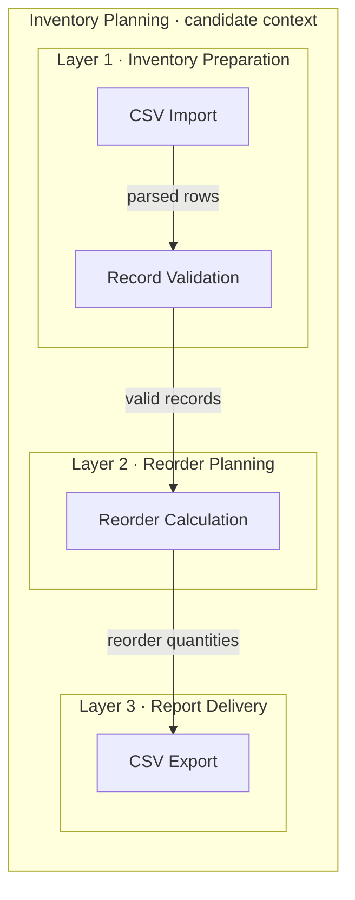

# Tasks 010 and 011 — illustrative behavioral review

These are author-produced walkthroughs using the revised instructions, not independent model evaluations or host compatibility tests. Fictional candidate data below exercise the contracts without making real product claims. Metadata results are recorded separately in the task execution records.

## Purchase framework

Input: “Help me decide what to look for in a keyboard for shared-office typing. I have no models yet.” Assume portability is secondary and nearby coworkers make sound important; budget is not supplied. Representative subset of the framework:

| Attribute | Importance weight | Status | Reason and assumptions |
| --- | --- | --- | --- |
| Sound | 5 | Suggested | Assume limiting disturbance matters in the shared office. |
| Layout | 4 | Suggested | Assume frequent writing and navigation; numeric entry needs remain unknown. |
| Connection | 2 | Suggested | Assume a mostly fixed desk with a usable USB port. |

| Attribute | Option | Suitability score | Status | Trade-offs and reason |
| --- | --- | --- | --- | --- |
| Sound | Quiet and damped | 5 | Suggested | Prioritizes the stated shared space; actual sound still needs checking. |
| Sound | Medium | 2 | Suggested | May be acceptable depending on room and neighbors. |
| Sound | Loud and clacky | 0 | Suggested | Poor match to the assumed noise goal; zero is not rejection. |
| Layout | Full-size | 4 | Suggested | Includes number entry, with more desk space required. |
| Layout | TKL | 5 | Suggested | Retains dedicated navigation without a number pad. |
| Layout | 75% | 4 | Suggested | Compact, with a less separated navigation cluster. |
| Layout | 65% | 2 | Suggested | More compact; assumes layers for some functions are acceptable. |
| Layout | 60% | 1 | Suggested | Smallest listed layout, with more reliance on layers. |
| Connection | Wired | 5 | Suggested | Fits the assumed fixed desk; adds a cable. |
| Connection | 2.4 GHz only | 3 | Suggested | Reduces cables; requires receiver compatibility. |
| Connection | Bluetooth only | 3 | Suggested | Useful for compatible devices; pairing may be a trade-off. |
| Connection | Multiple connection modes | 4 | Suggested | Flexible, but flexibility is not a stated priority. |

Adjustment opportunity: change any weight or score, add numeric-entry or portability requirements, or leave uncertain preferences blank. No product model, research, spreadsheet or tracker is needed to finish this framework. The connection choices above illustrate a partition; actual candidate interfaces may require adding options.

For “competitive gaming in a private room; mouse space matters; sound does not,” the same walkthrough changes sound weight to a suggested 1 and layout weight to 5; a 65% layout can receive a suggested 5 because mouse space is now explicit. These are contextual judgments, not measured performance claims or universal defaults.

Override case: the user supplies Layout weight 7 and TKL score 2. Both remain user-provided as 7 and 2, replacing the suggestions. If the user says “use your other recommendations,” only those identified suggestions become adopted. Without that instruction, suggested values remain unaccepted and cannot silently drive a ranking.

## Optional comparison and calculation boundaries

Fictional input supplied by the user: adopted Layout weight 3, TKL score 5; adopted Sound weight 2, Quiet score 5, Loud score `X`. This is a calculation fixture, not verified product research.

| Candidate | Raw Layout | Raw Sound | Expected outcome |
| --- | --- | --- | --- |
| A | TKL | Quiet | 3 × 5 + 2 × 5 = 25; maximum 25; 100%. |
| B | TKL | | Sound unknown stays blank; flag incomplete, do not rank as a complete 15-point result. |
| C | | Loud | Rejected by the known matched `X`, despite unknown layout. |
| D | Split | Quiet | Layout matches no option; flag the gap, do not guess a score. |

Removing the TKL score or Layout weight likewise blocks a complete comparable total. Review-sourced facts remain unverified, with their provenance visible; no supplied source becomes an invented official specification.

User values outside suggestion scales remain intact. For weights −1 and 2 with scores 5 and 4, the raw total is 3 but percentage normalization is unresolved. For weights 1 and −1, the denominator is zero: no percentage. A user score 7 is preserved, with the same unresolved-normalization warning. These checks preserve the existing formula rather than define a new normalization policy.

With no spreadsheet capability or accessible tracker, the deliverable remains tables; there is no file-generation or tracker-update claim. No live spreadsheet or tracker integration was exercised.

## Architecture: local CSV inventory

Input: “Propose an architecture for a local CSV inventory tool that imports rows, validates them, calculates reorder quantities and exports a report.” No code is supplied. Proposed logical responsibilities, not implemented components. Assume a user-supplied reorder rule; the formula and invalid-row handling remain open. One candidate Inventory Planning context is sufficient because all four responsibilities share inventory records and validation rules. The numbered groups are processing responsibilities, not deployment tiers. Arrows carry records from producer to consumer.

| # | Layer | Responsibility | Components |
| --- | --- | --- | --- |
| 1 | Inventory Preparation | Parse local inventory rows and check required fields and values. | CSV Import; Record Validation |
| 2 | Reorder Planning | Apply the supplied reorder rule to validated inventory. | Reorder Calculation |
| 3 | Report Delivery | Serialize the calculated report as CSV. | CSV Export |

| Context | Component | Layer | Responsibility |
| --- | --- | --- | --- |
| Inventory Planning | CSV Import | 1 · Inventory Preparation | Read and parse the local CSV into records. |
| Inventory Planning | Record Validation | 1 · Inventory Preparation | Check fields and values; surface invalid rows under a policy still to be agreed. |
| Inventory Planning | Reorder Calculation | 2 · Reorder Planning | Calculate quantities using an explicit reorder rule, without inventing its formula. |
| Inventory Planning | CSV Export | 3 · Report Delivery | Write report records in the requested CSV format. |

All four names and three groups match across graph and tables. There are no inferred network services, database or external integrations.

## Other architecture cases

- Purchase: the [updated overview](../../design/purchase-comparison/02-layered-components.md) has seven core components in two capability groups within one candidate context. Candidate comparison is optional. Category references are supporting files; spreadsheet and tracker capabilities are conditional and external. Graph and both tables agree.
- Sparse input, “Explain my inventory project”: without source or requirements, implementation is unknown. Ask for the project's purpose/source; if a proposal is useful, explicitly label its assumptions and candidate boundaries. Do not claim that the CSV example above describes that project.
- Existing architecture: this change updates `design/purchase-comparison/README.md` and `02-layered-components.md` in place. No competing design tree is created. The new skill points authors to existing project conventions before its fallback path.

## Review limitations

The examples show author reasoning against the acceptance scenarios. They are not independent approval, automated behavior tests, cross-host runs or measured recommendation quality. No functional script changed; unrelated functional suites were not run. Diagram rendering and inspection results are recorded in task 011 after execution.
